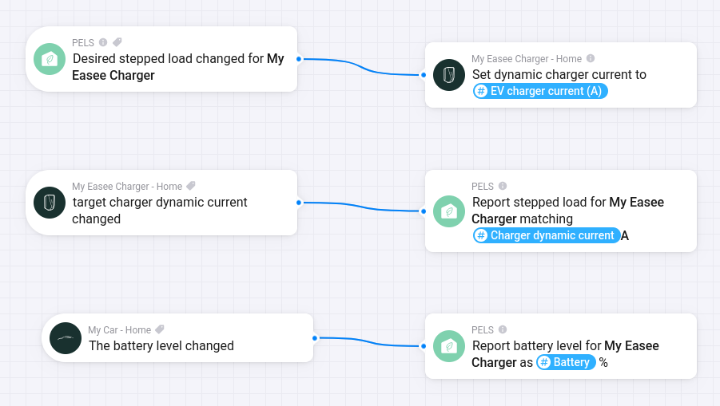

# Configure an EV Charger

## Automatic charging phases

With the community **Peblar EV Charger** integration, open the charger's
**Charging** section and choose **Charging phases**:

- **Leave to charger** leaves the phase setting with the charger.
- **Automatic** selects one or three phases using available power, solar and
  the current smart task.
- **One phase** requests single-phase charging.
- **Three phases** permits three-phase charging; the car can use fewer phases.

Before enabling it, select the house phase used for single-phase charging and
confirm that the installation has a 400 V three-phase supply with neutral and
that the charger and car support phase switching. This uses the same electrical
connection setting shown under **Power limiting**.

PELS lowers charging current before changing phases and keeps room for the
transition. It waits for independent power readings rather than treating the
requested setting as completed charging. Short solar changes do not cause
repeated switching. A transition that cannot be confirmed pauses further attempts
until the car reconnects.

Choosing **Leave to charger**, turning off management or enabling simulation
returns the phase setting PELS recorded before taking control. Returning to a
setting that permits more phases can pause charging first.

## Charging-current setup

Use this guide when an EV charger is paired in Homey and PELS should decide how much charging current is available.

For most supported chargers PELS controls charging through the charger's Homey app, with no Flow. Only a charger PELS cannot control directly needs a Flow that passes the PELS current to the charger app.

| Charger (Homey app) | How PELS controls it |
| --- | --- |
| **Easee** (Easee) | Directly, no key or Flow. See the [Easee guide](/easee-ev-charger). |
| **Alfen** (Alfen, or Alfen Pro-line/ACE) | Directly in whole amps from 6 A, no key or Flow. |
| **Peblar** (Peblar EV Charger by Kyle Michiels) | Sets the live charge limit directly in whole amps from 6 A, no key or Flow. |
| **Enua** (Enua) | Directly through the charger's charging power, in whole amps from 6 A, no key or Flow. PELS converts amps to watts from the charger's grid type. |
| **Zaptec** (Zaptec) | Directly. See the [Zaptec guide](/zaptec-ev-charger) for when it needs a Homey API key. |
| **Tesla** (Tesla Car & Energy) | Directly through the car. See [Tesla vehicle charging](/tesla-charging). |
| **Futurehome Charge** (Futurehome) | Directly, with a Homey API key. See the [Futurehome guide](/futurehome-ev-charger). |
| **Wallbox** (Wallbox Charger) | Directly, with a Homey API key under **Setup → Charging current**. |
| **amina S** (amina) | Directly, with a Homey API key under **Setup → Charging current**. PELS starts and stops charging with the charger's on/off switch. |
| **go-e Charger** (go-e Charger) | Directly, with a Homey API key under **Setup → Charging current**. PELS starts and stops charging with the charger's **Charging Allowed** switch. Set the maximum current no higher than your cable allows: the charger caps the current at the cable's rating. |
| **Smappee EV Wall** (Smappee) | Starts and stops charging through the charging mode: it pauses the charger and resumes it in standard charging. The app offers no current control. |
| **Zappi** (myenergi) | Starts and stops charging. The Zappi charges in the charge mode you chose in the myenergi app. |
| Another charger whose Homey app lets Homey set its charging power and publishes a power range for it | Directly through that power setting, no key or Flow. The device page offers **Automatic** with that range. |
| Any other charger | A current-control Flow (Step 3). |

A Homey API key with **Flow** permission is created with [Homey's API-key guide](https://support.homey.app/hc/en-us/articles/8178797067292-Create-and-use-API-Keys-on-Homey-Pro). Enter it under **Setup → Charging current** and choose **Save key and enable**; if a key is already verified, choose **Use built-in control**. One key works for all supported chargers and cars on this Homey.

If one of your Flows already sets the charger's current, PELS keeps that Flow working and leaves built-in control off or paused, because PELS cannot stop a Flow and the two would override each other. To switch, remove the Flow's current-setting action and choose **Check again**. Keep unrelated Flows, such as battery reporting.

## Before You Begin

- PELS must already be installed and configured with live whole-home power data.
- Your EV charger must already be paired in Homey.
- You need to know whether the charger should be controlled as 1-phase or 3-phase charging.

If PELS is not set up yet, start with [Getting Started](/getting-started).

## Step 1: Open the Charger Settings

Open **More -> Apps -> PELS -> Settings -> Devices**. The charger should appear there. Refresh the device list if it does not.

## Step 2: Choose the Control Model

Open the charger in the **Devices** tab and check **Control model**.

When PELS can read the charger's power levels from its Homey app, **Control model** offers **Automatic** and **Manual**. **Automatic** is the default for a newly managed charger: PELS takes the levels from the charger's own settings, such as its phases, grid type and current limits, and shows them as **Charging range**. It follows changes to those settings. A charger you set up before Automatic was available keeps its manual setup until you review Automatic; **Setup & recommendations** offers that review.

Otherwise, or under **Manual**, choose the EV model that matches your installation:

| Control model | Use when |
| --- | --- |
| **EV 1-phase** | 230 V single-phase charging. |
| **EV 3-phase** | Three-phase charging on a 400 V TN supply. |

The presets do not support 230 V IT three-phase charging. Neither preset is an accurate substitute for that supply and charging mode. Automatic uses the charger's own grid reading where the charger reports one, including IT three-phase.

The EV models let PELS calculate the current in amps and expose it as **EV charger current (A)**. A manual stepped-load setup can still work, but then you must convert watts to amps yourself.

Then configure the charger as a normal managed device:

1. Enable **Managed by PELS**.
2. Enable **Power-limit control**.
3. Set a priority that matches how important EV charging is compared with heaters, water tanks, and other managed devices.

Lower priority numbers are more important. Devices with higher numbers are limited first when PELS needs to stay under your grid import limit or hard cap.

Under **Setup → Default charging current limits**, save the minimum and maximum currents to use when the connected car has no saved range. This covers older cars without a Homey car device and cars PELS has not identified. Both values accept whole amps from 6 to 32.

In the charger's **Car** section, select the cars that charge there. Each selected car can have its own **Charging current limits**. When that car is matched or confirmed, its saved range replaces the charger default. The same car range follows it to other chargers. Selecting a car alone does not identify which car is connected. Clearing a car's range returns it to the charger default.

The minimum is the lowest current PELS requests while charging; PELS can still pause charging. The maximum also bounds attempts to raise the current. The charger's physical limits always apply. If no supported level fits the active range, PELS pauses charging. Changing the charger's phase configuration keeps the saved amp limits.

A charger whose **Automatic** model uses power levels in watts from its own settings, such as Zaptec, charges within those levels. Current limits do not apply to it, so its Setup has no default limits, and a car's limits apply when that car charges on another charger. An on/off charger also has no current for limits to set.

## Step 3: Create the Charger Current Flow (Only Without Direct Control)

Skip this step for every charger PELS controls directly (see the table above). Build it only for a charger PELS cannot control directly, or one where you chose a Flow instead: **Use a Flow** under **Setup → Charging current**, or **Use built-in device control** turned off.

Create the Flows that connect PELS to the charger app. The first Flow sends PELS' desired current to the charger. The second Flow reports the selected current back to PELS when your charger app can expose it.

*Figure 1. Example EV charger wiring: PELS emits the desired charger current, the charger reports the selected current back into PELS, and the car reports battery level for boost mode.*

### Send desired current to the charger

Use this Flow shape:

| Flow part | Card |
| --- | --- |
| **When** | PELS: **Stepped device target changed** for your charger |
| **Then** | Your charger app: set available charging current |

In the charger app action card, use the PELS Flow tag **EV charger current (A)** for the current value.

PELS handles the 1-phase or 3-phase conversion based on the control mode you selected in Step 2. Do not use **Planning power (W)** for a charger current field unless you are intentionally building a manual conversion Flow.

### Report selected current back to PELS

If your charger app reports the selected current, add this Flow:

| Flow part | Card |
| --- | --- |
| **When** | Your charger app: charger current changed |
| **Then** | PELS: **Report stepped load for** your charger **matching** the charger-current tag |

This feedback lets PELS confirm which charging level the charger selected. Use the charger app's current tag, not **EV charger current (A)**, in this feedback Flow.

When the reported value is amps, add `A` after the tag in the **matching** field, for example `[[Charger dynamic current]] A`. Without the `A` suffix, Homey may pass the number without a unit and PELS cannot reliably match it as charger current.

## Step 4 (Optional): Charge on Solar Surplus

If you have solar and PELS can see your export, you can have the charger follow the sun instead of running to your hard cap. In the charger's device page, turn on **Charge on solar surplus**.

PELS then picks the charging current your export covers and adjusts it as the sun changes. The default minimum is **6 A** — about 1.4 kW on one phase, 4.1 kW on three. If the active car or charger range has a higher minimum, surplus must cover that level. When it cannot, PELS falls back to the same **Power limiting** choice it uses for your hard cap: charging is turned off, or lowered to the step you picked and topped up from the grid.

Your grid import limit, hard cap and daily budget still come first, and a smart task with a deadline overrides this while it is running. See [Solar and Self-Consumption](/solar) for the full picture.

## Step 5: Configure Boost Mode Battery Reporting

This step is optional. Basic capacity control does not need battery reporting.

Choose one of these battery-reporting paths for boost mode and Smart tasks:

- **Selected car:** open the charger's **Car** section and select the supported cars that charge there. PELS uses the battery level of the car it matches to the charger. Selecting a car alone does not establish a match; while the page says **Waiting to identify the connected car**, the charger has no battery level, and its card on Overview says **no battery level**. PELS matches cars whether or not they are selected, and each car in the list says whether it has been matched to this charger, so you can check that matching works before you rely on it. When a car selected for another charger plugs in there, PELS matches it to that charger, not this one.
- **Charger reading:** leave the car selection empty. If the charger exposes a supported battery-percentage capability, PELS reads it directly.
- **Flow reporting:** leave the car selection empty and report a battery-percentage tag from the car or charger app using the Flow below.

You can select both cars if they share a charger. If each car always charges on its own charger, select it only there: two cars plugged in at the same time are then matched to their own chargers straight away. If your cars use either charger, select both cars on both chargers. PELS compares their plug-in reports
with the charger's report and uses the battery level only after it finds a match.
PELS matches a car as soon as its plug-in report arrives, even when the car's app
reports up to 20 minutes after the charger. If another car or charger reports within
the next 20 minutes and could match too, PELS drops that match and leaves the car
unmatched. Selecting a car does not force a match. A car whose plug-in report arrives
more than 20 minutes after the charger's is never matched automatically, even if it
is the only car selected, because it could have plugged in anywhere in that time.
After those 20 minutes the charger's card says **Could not identify the connected
car**; use **Confirm connected car** in the charger's **Car** section to match it by
hand. When every selected car reports unplugged, the card asks for this straight away,
since no match can come until a car reports its plug-in. In both cases the card offers
**Confirm car**, which opens the charger's **Car** section, even while another reason
holds the card.

While any car is selected, PELS ignores the battery-reporting Flow, even before a match is available. It does not provide a fallback reading. Clear the car selection to return to the Flow.
**Setup & recommendations** flags an enabled **Report battery level for charger** action for a charger with a selected car, so the ignored action can be removed or its Flow disabled when it is no longer needed. If no selected car has been matched to that charger yet, it instead suggests clearing the car selection so the Flow keeps working until the car shows as matched.

Use this Flow shape for boost mode:

| Flow part | Card |
| --- | --- |
| **When** | Your car or charger app: battery level changed |
| **Then** | PELS: **Report battery level for charger** |

Choose the same charger in the PELS action card, and map the battery percentage tag from the car or charger app to **battery level**.

With no car selected, this Flow supplies battery reports for the charger. EV boost mode can use the resulting battery level to let the charger take power from lower-priority devices while the car is below the configured boost threshold.

## Step 6 (Optional): Charge to a Battery Level

Without a target battery level, a charger under power limiting charges until the car stops, at the car's own charge limit. To keep the car at an everyday level instead, open the charger's device page and turn on **Charge to a battery level** in the **Charging** card, then set the level, for example 30%.

- **PELS stops charging at that level.** At or above it, PELS turns the charger off. Below it, the car charges as power allows. At 100%, PELS never turns it off: the car stops itself, and can keep heating or cooling from the wall.
- **A smart task charges further.** In the periods a smart task booked, the car charges past the level toward the task's target, for example 80% by 07:00. When the task ends, the level applies again.
- **PELS needs the car's battery level**, from a car selected under **Car**, from the charger itself, or from a Flow (Step 5). The status line under the setting says what the level means for the car on the cable right now.
- **Charge before the battery level is known** decides what happens to a car whose level PELS does not have: a guest car, a second car not selected under **Car**, a car whose app doesn't share its battery level, or your own car before its app reports in after you plug in. On (the default), such a car charges to its own limit. Off, it does not charge until PELS knows its level. An energy smart task (kWh by a time) still charges it in its booked periods; a battery level task needs the level to plan, so it waits too.
- **PELS needs Power-limit control** (or **Only PELS starts this device**) and a power reading from the charger to stop it. Without them, PELS only watches the charger and the status line says so.
- **A car kept below the level shows as held back.** When PELS keeps the charger paused for 15 minutes while the car's known battery level is below the level, its Overview card says **Held back**, and the **Held-back devices** widget offers **Let it run now**: a short smart task that aims to charge the car to the level within three hours.

Charge boost and **Charge to a battery level** do different jobs: boost takes power from lower-priority devices while the battery is below its level, and the battery level is where charging stops.

## Step 7: Check the Setup

Start with **Simulation mode** if you are still tuning the rest of PELS. Then verify:

1. The charger is visible as a managed device in PELS.
2. **Control model** is **Automatic**, or **EV 1-phase** or **EV 3-phase**.
3. Current control matches the charger: Easee, Peblar and Alfen Pro-line/ACE have **Use built-in device control** on. Alfen (the Alfen app), Enua and other chargers controlled through their charging power have no such switch: PELS always controls them directly. A Zaptec, Futurehome, Wallbox, amina, go-e or Tesla with built-in control shows **Built-in current control is selected** under **Setup → Charging current**. Only a charger PELS cannot control directly, or one you chose to keep on a Flow, receives **EV charger current (A)** in a current-control Flow.
4. Charging current changes in the charger app when PELS asks for a lower or higher level.
5. If you configured battery reporting, the charger's **Car** section or charging readout shows the battery percentage from your chosen source.

## Troubleshooting

| Problem | What to check |
| --- | --- |
| The charger is not listed in PELS | Confirm the charger is paired in Homey and choose **Refresh devices** under **Settings → Devices**. If it is still missing, choose **Request support** on the **Missing a device?** card there. |
| The Flow does not trigger | For a Flow-controlled charger, confirm it is managed, power-limit control is enabled, and PELS has live whole-home power data. If the charger is in the table under [Charging-current setup](#charging-current-setup), use built-in control instead of the Flow. |
| The charger receives the wrong current | Under **Manual**, check that the device uses the correct **EV 1-phase** or **EV 3-phase** model. Under **Automatic**, check the phase and current settings in the charger's own app. |
| Battery level does not update in PELS | If a car is selected, check whether PELS has matched it to the charger and whether that car is available in Homey. Otherwise, check that your battery-reporting Flow selects the correct charger. |
| PELS never limits the charger | Check the charger priority, your limits in **Limits & safety**, and whether Simulation mode is still enabled. |

For problems beyond the charger — budget, capacity, or a missed task — see the full [Troubleshooting guide](/troubleshooting).

## Related Pages

- [Getting Started](/getting-started)
- [Configuration](/configuration)
- [Flow Cards](/flow-cards)
- [Deadline Charging With State of Charge](/how-to-deadline-charging-soc)
- [Easee EV Charger](/easee-ev-charger)
- [Zaptec EV Charger](/zaptec-ev-charger)
- [Futurehome EV Charger](/futurehome-ev-charger)
- [Tesla vehicle charging](/tesla-charging): control the car through Tesla Car & Energy.
