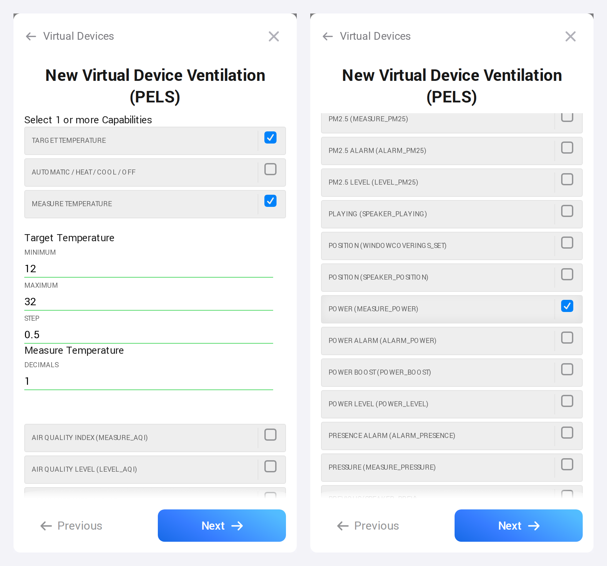
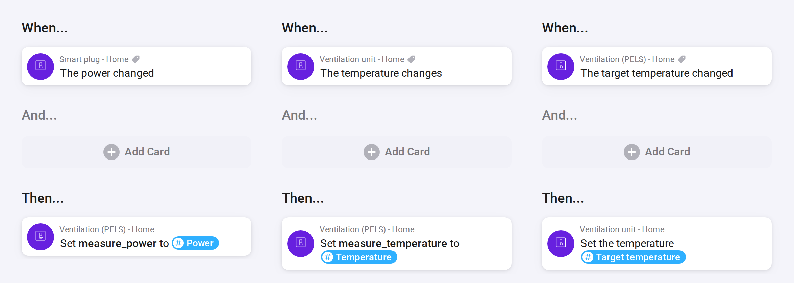

# How-To: Limit a Temperature Device Through a Virtual Thermostat

Use this pattern when PELS should limit a device by lowering its temperature, but the device's Homey app reports no power, and a separate meter measures what it draws. A typical case is a ventilation unit with an electric air heater, plugged into a smart plug that measures power.

PELS limits a device only when it has a power reading for that device. Here the reading and the temperature setting sit on two different Homey devices. A virtual thermostat brings them together: PELS manages the virtual thermostat, and three Flows connect it to the real device and the meter.

Don't let PELS manage the smart plug itself. PELS would limit it by switching it off, which stops the whole unit, fans included.

## What You Need

- The device's Homey app, with a target temperature you can set from a Flow.
- A smart plug or sub-meter that reports the device's power in Homey.
- The [Virtual Devices](https://homey.app/a/com.arjankranenburg.virtual) app.

## 1. Create the Virtual Thermostat

1. In Homey, add a new device, choose **Virtual Devices**, and select **Connect**.
2. Give it a name, for example the name of the real unit, and pick an icon.
3. Under **Device Class**, choose **Thermostat**.
4. Under **Capabilities**, keep **Target temperature** and **Measure temperature**, and also select **Power (measure_power)** further down the list.
5. Under **Target Temperature**, set **Minimum** at or below the limited temperature you will use in PELS. It starts at 12 °C.
6. Select **Next** to add the device.

*Figure 1. The capabilities step: the two temperature values are selected for a thermostat, and Power is selected by hand.*

These settings cannot be changed afterwards. If you miss **Power**, delete the device and add it again.

## 2. Connect It With Flows

Make three Flows:

| When | Then |
| --- | --- |
| The smart plug's **The power changed** | The virtual thermostat's **Set a virtual sensor value**: set `measure_power` to the plug's power. |
| The real device's **The temperature changes** | The virtual thermostat's **Set a virtual sensor value**: set `measure_temperature` to the device's temperature. |
| The virtual thermostat's **The target temperature changed** | The real device's **Set the temperature**, to the virtual thermostat's target temperature. |

*Figure 2. The three Flows, in the order of the table, for a unit called Ventilation unit and a virtual thermostat called Ventilation (PELS).*

**Set a virtual sensor value** lists the virtual thermostat's values by their Homey names, so pick `measure_power` and `measure_temperature` there. The third Flow passes on every change PELS makes to the target.

For the two measurement Flows, use the source device's own reading tag as the value. This lets you run each Flow once to copy its current reading, without waiting for the next change.

## 3. Set the Initial Values

Virtual Devices does not set initial values when you create the device. Before adding it to PELS:

1. Open the virtual thermostat's tile in Homey and set its target to the temperature you want. The third Flow also sends this first setting to the real device.
2. Run the power and measured-temperature Flows once to copy the source devices' current readings.
3. Check that the virtual thermostat shows a target temperature, measured temperature and power reading. A power reading of 0 W is valid when the device is not drawing power.

PELS needs both a target temperature and a measured temperature to recognize the virtual thermostat's temperature control.

The smart plug and the virtual thermostat now report the same power, so Homey Energy counts it twice. To count it once, open the smart plug's settings in Homey and turn on **Exclude from Energy** under **Advanced Settings** > **Energy**. PELS still reads the power from the virtual thermostat.

## 4. Add It to PELS

1. Open PELS's **Devices** page and select **Refresh devices**, then open the virtual thermostat and turn on **Managed by PELS**. Leave the real device and the smart plug unmanaged.
2. Set its temperatures under **Temperature per mode**. PELS sends them through the third Flow.
3. Under **Power limiting**, set **Limited temperature** to a temperature at which the heater stays off.

PELS now sees the unit's real power. When it needs room under your limit, it lowers the target to the limited temperature, the heater switches off, and the plug's reading drops. When power allows, PELS sets the mode's temperature again.

After setup, change the temperature in PELS: the virtual thermostat does not see changes made in the real device's own app.
