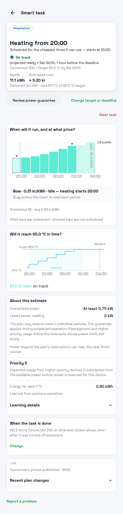

# Smart Tasks

Smart tasks tell PELS that one device should reach a target by a ready-by time.

PELS plans the cheapest available times before the ready-by time, using the device priority, daily budget, power-limit control, and house power limits already configured. The plan shows when the device should run and whether PELS expects it to reach the goal in time.

## What Smart Tasks Are For

Use a Smart task when the timing matters for one device:

- Charge an EV to a target battery percentage by 07:00.
- Heat a room to a target temperature before people wake up.
- Heat a water heater before a period when hot water matters.
- Deliver 6 kWh overnight to a water heater on a relay, when it has no temperature reading of its own.

If you only want the whole home to spend more energy during cheap hours, use [Daily Energy Budget](/daily-budget) instead. If you want a fixed number of cheap hours without a target, use [Book Cheap Hours With Flows](/how-to-book-cheap-hours-with-flows).

## How a Task Is Created

The quickest way is **New smart task** on the **Smart tasks** page: choose a managed device, set the goal and ready-by time, and PELS previews the times it plans to use and the estimated cost before you create the task. A device's own page offers the same as **Add smart task**, and shows the device's current task with a link to it once there is one. A device carries one task at a time, so choosing a device that already has one opens that task instead.

The preview also says what happens to the device **When the task is done**, from the device's own settings (see [Power-Limit Control and Tasks](#power-limit-control-and-tasks)). **Change** opens those settings without losing what you have typed.

For tasks at fixed times, open **Settings → Schedules → New schedule**, choose **Create Smart task**, and set the device, goal, creation time and ready-by time. Run it once or repeat it on the days you choose. Each occurrence replaces the device's current task and keeps its extra permissions. Permissions enabled in the schedule apply whenever the task is planned to run; permissions left off keep their existing settings. Switching a schedule off stops future creations; a task it already created stays active.

Use Homey Flow action cards for event-based creation, such as plugging in a car, or when other Flow conditions should decide whether to create the task:

| Action card | Use for |
| --- | --- |
| **Add charging task** | EV chargers with a battery target and ready-by time |
| **Add heating task** | Temperature devices with a target temperature and ready-by time |
| **Add energy task** | On/off devices and EV chargers with a live power reading, with an amount of energy (kWh) and ready-by time |
| **Clear smart task** | Removes the active task for the selected device |

The ready-by value is written as local time, for example `07:00`. PELS stores the next matching future time when the Flow runs. It does not automatically repeat the same task every day unless your Flow runs again.

The **Create smart task** widget is for one-off dashboard creation without a Flow. It offers managed heating devices and EV chargers, with quick targets and ready-by times. Energy tasks for on/off devices are created from the Smart tasks page or the Flow card. Choose a target and **Start**, or choose **Customize** to set your own goal and ready-by time, preview the scheduled periods and cost estimate, then create the task. If the preview says **Cannot finish**, the widget warns that the goal may not be reached in time. You can edit the task or choose **Create anyway**; the task still respects your power limits. See [Dashboard Widgets](/widgets) for the full widget set.

## What PELS Plans

For each active task, PELS evaluates:

- the target
- the current observed progress, when available
- the ready-by time
- price periods through the ready-by time
- the device's expected or learned energy delivery
- the daily budget and enabled house power limits
- the device priority and normal admission rules

The Smart task plan uses the price source’s periods: whole hours or individual 15-minute periods. If prices are available for the whole window, cheaper periods are preferred. If tomorrow's prices are needed but not available yet, the task can remain pending until the price window is complete.

On an eligible charger's device page, under **Charging**, **Avoid short charging breaks** is offered with 15-minute pricing. Turn it on to keep new Smart task charging together. PELS can charge through a pricier break of up to 15 minutes when that raises the total planned cost by no more than 5%. It moves energy from a later block rather than adding extra charging, and it does not move charging away from planned solar. The setting is off by default. Existing schedules keep their booked energy; turning the setting off allows ordinary price-based pauses again. Power limits, higher-priority devices and the task's target still apply.

When several Smart tasks want the same period, PELS plans the highest-priority device first. The next task uses only the power and budget still available: it may share the period when both devices fit, move to another period, or warn that it cannot finish. Give the devices different priorities when their order matters.

*Figure 1. A Smart task plan answers two questions on two charts: when the device will run and at what price, and whether it will reach its target in time. Tap or drag across the chart for each period’s readout.*

## Understanding the estimate

**About this estimate** separates the power reserved for the task from the energy it is expected to need:

- **Guaranteed power** is the minimum planning power for scheduled operation. Individual periods may reserve more. It depends on background usage and higher-priority devices following their forecasts; house power limits still apply.
- **Latest power reading** is what the device last reported, not the power promised for a future period.
- The priority explanation shows which devices are ahead of this task. **Learning details** describes the energy estimate used to predict progress. Energy tasks count delivery directly and show **Measurement details** instead.

A power guarantee is not a guarantee that the device reaches its target: the outcome also depends on how much energy it needs and whether it accepts the planned power. Extra available power can help it finish sooner. **Review power guarantee** lets you preview the effect of permissions before saving; **Change target or deadline** changes what the task needs to achieve.

## Why the Plan Changed

PELS shows what triggered each replan:

- On the **active task** page, the **Recent plan changes** panel lists the reasons in order, most recent first — for example *Tomorrow’s prices published*, *Rate estimate refined*, or *Schedule revised — daily budget shifted*.
- On a **past task**, the **What changed** card on the history-detail page tells the same story for the finished run.

The panel collapses itself when every revision came from a Flow card (the user already knows what they did).

## Power-Limit Control and Tasks

While a task is active, a period outside its plotted plan can mean two different things: the task can finish without that period, or the task keeps the period even though the forecast left no room for energy there. A task keeps such a period when it is cheaper than the periods it plans to use, or when it cannot reach its target otherwise. It promises nothing for that period, but the device runs if power turns out to be available.

| Device setup | The task defers this period | The task keeps this period without planned energy | The task planned this period |
| --- | --- | --- | --- |
| **Power-limit control on** | PELS holds the device off, even if power is available. | The device runs when power turns out to be available, within enabled house power limits. | PELS gives the task an opportunity to run within enabled house power limits and normal admission rules. |
| **Power-limit control off** | PELS does what **Power limiting** is set to (for example, turns it off), unless another automation controls it. | The task makes the device available; it runs when power turns out to be available. | PELS makes the device available for the planned task period. |

In a period kept without planned energy the task does not limit or pause lower-priority devices to make room. It uses only power that is actually free.

For EV charging, a common setup is to keep the charger managed by PELS but turn power-limit control off. This prevents ordinary run-when-power-is-available behavior when no active task controls the charger. An active task can still charge in a period it keeps without planned energy when power is available; turning power-limit control off does not restrict charging to only the periods shown in the plotted plan. A deferred period is different: PELS keeps the device off during that period.

### When the task is done

A task is done at its ready-by time. Until then the task decides what the device does, also once it has reached its goal: it holds the device back in the periods it does not plan to use, and a mode change never sets a less demanding target than the task's, while a more demanding mode target still applies. If the device moves away from the target again, the task plans to top it up in its cheapest remaining periods. A Flow's **Set temporary temperature for device** is the exception: while it lasts, the task leaves a temperature device alone, then carries on with the time left.

After the ready-by time, the device's own settings decide again: the task page's **When the task is done** card says what they do.

| Device settings | What the card says |
| --- | --- |
| **Power-limit control** on | PELS turns the device on whenever power allows, even after it was turned off elsewhere (for example a charger paused in its own app). |
| **Power-limit control** on, with **Leave off until turned on again** | PELS turns the device on whenever power allows, unless it was turned off elsewhere. |
| **Power-limit control** on, with a solar-surplus setting such as **Run on solar surplus** | PELS runs the device on your solar surplus. |
| **Power-limit control** off, with **Only PELS starts this device** | PELS keeps the device off until a smart task needs it. If it is started elsewhere, PELS turns it off again. |
| **Power-limit control** off | At the ready-by time, PELS does what **Power limiting** is set to, such as turning the device off. After that, PELS does not start it, and leaves it running if it is started elsewhere. |

The device page states the same rule under **Power-limit control**, beginning with *When no smart task is running* while a task is in progress. **Change** on the card opens the device page at **Power-limit control**. **Only PELS starts this device** appears there, while **Power-limit control** is off, once the device has had a smart task.

## Budget and Task Interaction

Smart tasks compose with the rest of PELS — every layer keeps working underneath the task:

- **Capacity limit**, when enabled, protects the **hard cap** over the selected hourly or 15-minute averaging period.
- **Grid import limit**, when enabled, limits current grid import. Either limit can be used on its own, both can apply, or both can be off. Price-period length and capacity averaging period are separate settings.
- **Daily budget** holds the task to a sensible pace when the day is already running hot.
- **Priority** decides which devices get room first when something has to wait.
- **Price-based temperature shift** keeps adjusting normal targets; a heating task target becomes the readiness target for that task.

## Letting a Task Push Harder

By default a Smart task stays polite: it keeps to the daily budget and never takes power from devices you have ranked higher or equal. If a task is **At risk** of missing its target and the deadline matters, you can grant it extra leeway.

Four places set these permissions:

| Where | Use for |
| --- | --- |
| **Smart task page → Review power guarantee** | Turning a permission on **or off** for an existing task, with the estimate re-priced under the change before you save. |
| **Smart tasks page → New smart task → Extra permissions** | Granting any of the three while creating the task (**limit lower-priority devices** only for devices with power levels). The preview is priced with them. |
| **Create smart task** widget | Granting any of the three while creating the task (**limit lower-priority devices** only for devices with power levels). |
| **Set what a smart task may do** action card | Granting a permission from a Flow — for example only once a task reports **At risk**. |

| Permission | What it allows |
| --- | --- |
| **go over today's budget** | The device may keep running during its planned periods even when the daily budget would normally pace it down. The daily budget is a soft, price-shaped target, so this lets the task run past it. |
| **limit lower-priority devices** | The task may limit lower-priority devices that are **currently drawing power**, turning them down or off, so it gets the power it needs. Devices at the same or higher priority are never touched. The cost is that devices you ranked lower can be held back longer, whether or not they have a smart task. |
| **reserve power so this task can start sooner** | PELS reserves the power the task needs to start, so it can start sooner. A device that needs a clear block of power to begin, such as an EV charger or a water heater, cannot start on scraps, so lower-priority devices are not turned back on until it has started. Nothing is switched off to make room, and devices at the same or higher priority are never affected. The cost is that devices you ranked lower can be held back longer, whether or not they have a smart task of their own, so use it for a task that matters more than they do. |

The Flow card also asks when the permission applies:

| When | Effect |
| --- | --- |
| **At no time** | The permission is off. |
| **While it's scheduled to run** | The permission applies during the task's planned periods, and stays set until you change it or clear the task. |

The task editor’s **Extra permissions** toggles and the **Create smart task** widget set the same thing as **While it's scheduled to run**; switching a toggle off is the same as **At no time**.

**limit lower-priority devices** is offered only for devices with power levels, such as a water heater with several heating steps. It works on its own: it makes room by turning down lower-priority devices, within enabled house power limits and today's budget. To let the task use more than today's budget allows, also turn on **go over today's budget**. Editing a task only changes the permissions the page shows you — with one exception: a permission that can have no effect on the device may be dropped when you save.

Use **Review power guarantee** to preview permission changes before saving. If no plan inputs are available yet, the action is labelled **Edit task**. Changing only the permissions re-plans the task and keeps the current run going. Use **Change target or deadline** to change the goal or ready-by time; that starts a new run, and the run so far moves to **Past tasks**.

Two things stay true no matter what you grant:

- All three permissions respect the enabled house power limits. They do not raise the **hard cap** or **Grid import limit**. If a task still cannot finish, review its target, ready-by time, competing loads and the reason PELS gives.
- Permissions persist once you grant them and can affect scheduled operation even while the task is **On track**. Limiting lower-priority devices and reserving startup power apply in periods with planned energy. A period kept without planned energy uses free power only; it does not take power from lower-priority devices.

### Example: a water heater that must be ready

A water heater is set to reach 65 °C by 07:00 with cheap overnight periods scheduled. Someone showers at 21:00 and the tank drops well below target, leaving the morning short. To keep mornings covered, grant the task any of its permissions:

- **go over today's budget** so the heater can reheat during its planned periods even if the day's budget is tight.
- **limit lower-priority devices** so it can claim power from loads you care about less.
- **reserve power so this task can start sooner** so PELS reserves the power the heater needs to start, instead of letting smaller loads take it a slice at a time.

You can grant the leeway as a standing setting once the task exists — open the task and use **Review power guarantee** — or only when time is short. Pair **Smart task time is running low** (for example, 2 hours left) with **Smart task status is At risk** so a Flow grants the permission late — only when a task actually needs the help.

The **Held-back devices** dashboard widget uses the same create engine for a narrower case: a device PELS has kept below its target temperature or battery level for 15 minutes can get **Let it run now**, which creates a short Smart task with budget leeway and permission to take room from lower-priority devices. It never raises your house power limits. A device that already has its own Smart task does not get the button: that task is what brings it back.

## Different Targets Can Be Useful

A mode target, a boost setting, and a Smart task target do not have to be the same value. They describe different intent:

| Setting | What it means |
| --- | --- |
| **Mode target** | The normal target for the active mode, such as Home, Night, or Away. |
| **Boost setting** | A temporary extra push, such as cheap-hour temperature boost or charge boost when a battery is low. |
| **Smart task target** | A one-off readiness goal by a specific time. |

That separation is often useful. For example, a room can normally sit at 18 °C in Night mode, use cheap-hour boost when prices are low, and still have a task to reach 21 °C by 06:30. An EV charger can have a low charge-boost threshold for basic readiness while a charging task aims for a higher target before a trip.

For many homes, this is the useful combination:

1. Power limiting respects the house power limits you enable.
2. Daily budget shifts whole-home usage toward cheaper hours.
3. Smart tasks reserve attention for specific devices that must be ready.

## Energy tasks

An energy task asks PELS to deliver an amount of energy to a device before the ready-by time, for example `6 kWh` by `06:00`. It works with plain on/off devices such as a water heater switched by a relay, and with EV chargers. For an EV charger, you can choose an energy target whether or not you have a linked car or battery reading. The target counts electricity supplied through the charger, including charging losses; it does not promise a final battery percentage.

Progress is the energy the device takes after the task starts, counted from its power readings. PELS then plans exactly like any other Smart task: it spreads the remaining energy over the cheapest periods before the ready-by time, within enabled house power limits and, unless you allow more, the daily budget, and switches the device off once the energy has been delivered.

Which devices can take one: plain on/off devices and EV chargers, including chargers with current control. Other stepped loads, thermostats and other devices with a target temperature are not eligible. The device also needs a live power reading, its own power measurement or Homey Energy's live figure for it. A device that only reports a cumulative energy meter is not offered, because its power figure lags behind switching it on and off.

**For an EV charger**, use the **Add energy task** Flow card, select the charger, and set an amount such as `20 kWh` by `07:00`. While a charger is plugged in and PELS has no battery level for the car, **New smart task**, the device page's **Add smart task** and the **Create smart task** widget offer an energy task instead of a battery target, and the widget offers `10 kWh` to `40 kWh` as one-tap choices. Otherwise they create battery-target tasks. Existing energy tasks can be viewed and edited in the settings UI. If the car stops accepting charge before the requested energy is delivered, the energy task can end as missed even if the car is full.

A task starts when it is created. For a nightly task, use **Settings → Schedules** to create it at 22:00 with ready-by `06:00`. A Flow running **Add energy task** at 22:00 works too. Running that card again for the same ready-by time keeps the energy already delivered; a new night starts from zero.

A device that switches itself off when it is done stops taking energy. A water heater's own thermostat does this once the tank is hot. When the device takes no power for about 15 minutes while its task is scheduled and PELS lets it run, the task shows **At risk** with the reason "Device stopped taking power", and it can end as missed even though the tank is full. Pick an amount the heater actually takes on a normal night, or treat that outcome as "the tank was already hot". From then on the task stops holding its scheduled periods for itself, so other Smart tasks can take them at the next hourly re-plan. It holds them again when the device draws power, and also after a period the task does not keep or a moment PELS holds the device back: the next time PELS lets it run, the device gets another 15 minutes before they are freed again. The task stays **At risk** for that reason until the device draws power again; PELS limiting the device in the meantime does not change it back to **On track**.

## Status and History

The Smart tasks view shows current tasks and past tasks. Flow cards can also react when the saved status changes.

| Status | Meaning |
| --- | --- |
| **Building plan…** | A task is stored but PELS has not scheduled operation yet — usually because prices through the ready-by time are not available. |
| **Paused — unplugged** | EV only: the charging task is paused because the car is unplugged or the session ended. The plan resumes when the car is plugged back in. |
| **Paused — not managed** | **Managed by PELS** is off for the device, so PELS is not planning anything for it. The task is kept, not deleted: turn **Managed by PELS** back on and the plan resumes on the next cycle. |
| **On track** | PELS currently expects the task to reach the target — including when the plan is ready but the first scheduled period is still in the future. |
| **At risk** | PELS has a plan, but there is limited time or room left, or the device itself is holding delivery back: it stopped taking power while PELS let it run, or (EV) the car's own charge limit is below the target, or the car is delaying charging on its own schedule. PELS limiting the device for a house power limit, the daily budget or a higher-priority device does not change the status on its own: the plan already accounts for it. |
| **Cannot finish** | PELS does not currently see enough usable time or energy delivery before the ready-by time. |
| **Satisfied** | The observed target is already met. For a heating or charging task, if a later reading drops below the target before the ready-by time, PELS returns to tracking it; delivered energy only ever goes up. |

An EV task keeps the target you set even when the car's own charge limit is lower. As soon as PELS knows the car's limit is below the target, the task reads **At risk** (or **Cannot finish**) with the limit as the reason, because the car will stop short. Raise the limit in the car, or set the task's target to the car's limit. While the car is still charging toward its limit, today's daily budget is named instead when it is what holds the task back, since a higher car limit would not finish the task. A car unplugged before it reaches its limit shows **Paused — unplugged**.

If no active task is stored for a device, that device simply has no Smart task status.

Use **Smart task status changed** for notifications after PELS saves a new status. Use **Smart task ended** when you want an alert after the task run concludes.

### Outcomes

The **Smart task ended** trigger fires once when a task run concludes, with an **Outcome** tag:

| Outcome | What it means |
| --- | --- |
| **succeeded** | The task reached its target by the ready-by time. |
| **missed** | The target was not reached by the ready-by time. The cause can be on PELS's side (not enough time, power or budget) or on the device's side (it stopped taking power, or the car stopped at its own charge limit). The history entry names it. |
| **abandoned** | The task was finalized before it could complete — either because **Clear smart task** ran (manually or from another Flow), or because the device stopped reporting for about an hour while the deadline was still in the future. |

Filter on the tag when only some outcomes should notify, for example `Outcome = missed` for a "did not reach target" alert. An **abandoned** outcome is usually not a planning failure — it means the situation changed before the task could complete.

Three things that look like an abandonment but aren't:

- A *briefly* unplugged EV shows the **Paused — unplugged** status and resumes when plugged back in. Only an unplug that lasts past the abandon grace window finalizes the task as **abandoned**.
- Turning **Managed by PELS** off for a device does not delete its smart task. The task shows **Paused — not managed** and waits. Turn the switch back on and it resumes. If the ready-by time passes while it is still paused, the run ends as **missed** — or as **abandoned** when PELS never recorded a reading for the device during that run, which is the same rule every other unfinished run follows.
- A new smart task that replaces an in-progress one produces an internal `replaced` outcome. The **Smart task ended** trigger is intentionally suppressed in that case so the new task isn't shadowed by an ended-trigger for the old one.

## If a Task Missed

When the **History** view shows a missed entry, PELS surfaces at most one recourse button. The button reads **Review device** unless the daily budget was the last thing holding the task back, or the car itself was: a car that stopped at its own charge limit or delayed charging on its own schedule gets no button, because no PELS setting changes the car. The cause sentence names that last blocker, plus the earlier one that held delivery back longest.

| Recourse button | What happened | What to do |
| --- | --- | --- |
| **Lower daily budget** | The daily energy budget ran out before the ready-by time. PELS had periods scheduled but the budget cap closed those periods down. | Lower the daily budget so future days reserve usable power earlier — in the **Budget** tab or via the **Set daily budget** Flow card. Raising the **hard cap** is not the right answer: the hard cap reflects your grid tariff step, not a tuning knob. |
| **Review device** | Any other last blocker: the device stopped taking power, not enough available power was left, a higher-priority device took the room, or the plan did not leave enough time. | The button deep-links you to the device-settings overlay. Check stepped-load planning power, target temperature, priority, **What PELS does when limiting this device**, and the Flow wiring that reports state back to PELS. |
| (no button) | The car stopped at its own charge limit, or delayed charging on its own schedule or smart charging. | Raise the car's charge limit, or turn off its own charging schedule, in the car. |

If the same device misses repeatedly, treat it as a tuning loop:

1. Read the cause sentence on the history-detail card.
2. Apply the recommended recourse.
3. Compare the next run.

If the task needs more room only on the run before the deadline, **Set what a smart task may do** can grant *go over today's budget* or *limit lower-priority devices* permission for the scheduled periods — see [Letting a Task Push Harder](#letting-a-task-push-harder).

For **abandoned** runs, the usual answer is that there is nothing to fix. Only investigate if the abandonment was unexpected — for example, a Flow you didn't expect ran **Clear smart task**, or an EV unplug event fired when the car was still connected.

## Practical Examples

### Charge an EV by morning

Create a Flow that runs when the car is plugged in:

| Flow part | Card |
| --- | --- |
| **When** | Charger or car app: plugged in |
| **Then** | PELS: **Add charging task** |

Set the target battery percentage and ready-by time, for example `80 %` by `07:00`.

Recommended charger setup:

- **Managed by PELS** on
- **Power-limit control** off by default to prevent ordinary run-when-power-is-available behavior when no active task controls the charger. An active task may still charge in a period it keeps without planned energy; see [Smart Tasks](/smart-tasks#power-limit-control-and-tasks).
- **Only PELS starts this device** on, if the charger should charge only for a task. A charger that starts a session by itself when the car is plugged in is turned off again, so the car charges only in the periods the task keeps. It appears on the device page, under **Power-limit control**, once the charger has had its first smart task.
- Current control configured as described in [Configure an EV Charger](/ev-charger): built-in control for a supported charger, otherwise a current-control Flow.
- A battery level for the car: a selected car, the charger's own reading, or a battery-reporting Flow

### Heat a water heater on a relay overnight

Under **Settings → Schedules**, create a Smart task schedule for the relay at `22:00`, repeating on the nights you need it. Choose an energy target, for example `6 kWh`, and ready-by `06:00`. A time-triggered Flow using **Add energy task** is another option. PELS runs the relay in the cheapest periods before 06:00 until the heater has taken 6 kWh. As with a charger, keep **Power-limit control** off for the relay so PELS does not run it on available power between tasks; while a task is active, the task decides when it runs either way. See [Power-Limit Control and Tasks](#power-limit-control-and-tasks).

### Heat before a known time

Under **Settings → Schedules**, create a Smart task schedule for the temperature device at `20:00`. Set the target temperature and ready-by time, for example `21 °C` by `06:30`, and choose the days it repeats. Use the **Add heating task** Flow card instead when a Homey event or condition should create it.

This is useful for rooms or water heaters where the exact ready time matters more than simply reacting to the current price level.

## Troubleshooting

| Problem | What to check |
| --- | --- |
| The task stays pending | Check that **Respond to prices** is on under **Price-aware devices** and that prices are available through the ready-by time. |
| The EV task does not change charger current | Confirm the charger's **Control model** is **Automatic**, EV 1-phase or EV 3-phase. Check the control method selected for the charger: built-in device control, or a current-control Flow using **EV charger current (A)**. See [Configure an EV Charger](/ev-charger). |
| The device starts in a period outside the plotted task plan | The task keeps that period without planned energy, because it is cheaper than the planned periods or the task cannot finish otherwise, and runs there when power is available. A deferred period is held off. With no active task controlling the device, **Power-limit control** on allows normal run-when-power-is-available behavior. |
| The task cannot meet the target | Check target size, ready-by time, planning power/current, daily budget, and device priority. |
| A completed task starts tracking again | This is expected if a fresh reading drops below the target before the ready-by time. |

For problems beyond Smart tasks — capacity, budget, or missing data — see the full [Troubleshooting guide](/troubleshooting).
