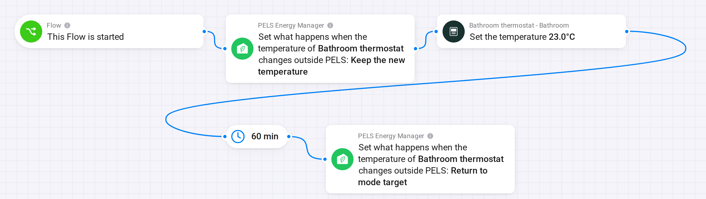

# Temporarily change one heater's temperature with Homey Flows

Warm the bathroom for an hour, heat the basement for a film, or keep a guest room at a fixed temperature overnight. PELS holds the thermostat at the temperature for the time you choose, then returns it to normal control.

Choose by who should set the temperature meanwhile.

| | Keep PELS in control | Hand the thermostat to a Flow |
| --- | --- | --- |
| **Who sets the temperature** | PELS, using the value from the Flow | The Flow or the thermostat itself |
| **Price and solar adjustments** | Paused for this device | Paused for this device |
| **Limiting by lowering the temperature** | Stays on | Paused for this device |
| **On/off limiting** | Stays on | Stays on |
| **Best for** | Most temporary changes | Virtual thermostats and Flows that set the temperature themselves |

## Keep PELS in control

Use **Set temporary temperature for device**. One card is enough: PELS ends the temporary temperature itself.

1. Add **This Flow is started**, or any other trigger, such as a button.
2. Add **Set temporary temperature for device**. Choose the thermostat, enter the temperature and the number of minutes (up to 1440, one day).

PELS sets the thermostat to exactly that temperature, without price or solar adjustments, and the device card reads **Temporary temperature from a Flow**. When the time is up, PELS returns the thermostat to the target of whichever mode is active, with its adjustments. A mode change in the meantime does not end it, and neither does a Homey restart.

Power limiting still applies: if PELS needs the power, it lowers the thermostat to its limit temperature and goes back to the temporary temperature when the limit ends. A Smart task on the thermostat keeps it at least at the task's temperature.

Running the card again replaces the temperature and starts the time again. The card works with **When the temperature changes outside PELS** set to **Return to mode target** or **Save as current mode target**, and is not available with **Keep the new temperature**.

## Hand the thermostat to a Flow

Use this when something other than PELS should set the temperature for a while, such as a virtual thermostat with its own logic.

*Figure 1. PELS leaves the thermostat's temperature alone for 60 minutes, then takes it back.*

1. Add **This Flow is started**, or any other trigger.
2. Add **Set what happens when a device's temperature changes outside PELS**, with **Keep the new temperature**.
3. Add the thermostat's own **Set the temperature** card.
4. Add a delay of the length you want.
5. Add **Set what happens when a device's temperature changes outside PELS** again, with **Return to mode target**.

When the last card runs, PELS plans again immediately and sets the thermostat to the target of whichever mode is active. If PELS is limiting the thermostat at that moment, it goes to its limit temperature first and on to the mode target when the limit ends.

A mode change during the delay does not change the temperature. On/off limiting keeps working and follows the new mode's device priorities.

## End it with an event instead of a timer

To end a session when something happens, such as a switch turning off, add **End temporary temperature for device** to a second Flow with that trigger. Set the duration long enough to cover the session. In the handover recipe, leave out the delay and put the last card in the second Flow.

## Related

- [Flow Cards](/flow-cards)
- [Use Home, Away, Night and Vacation modes for energy behavior](/use-cases/homey-home-away-night-energy-modes)
- [Smart Tasks](/smart-tasks), to reach a temperature by a set time in the cheapest hours
