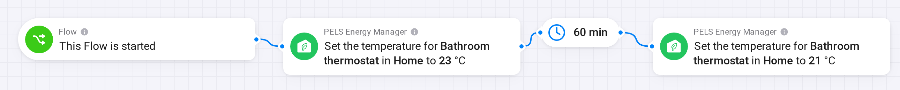

# Temporarily change one heater's temperature with Homey Flows

Warm the bathroom for an hour, heat the basement for a film, or keep a guest room at a fixed temperature overnight. A Homey Flow decides when this starts and ends, and PELS returns the thermostat to normal control afterwards.

Both recipes below use a Flow with a delay. Choose by who should set the temperature while the override runs.

| | Keep PELS in control | Hand the thermostat to a Flow |
| --- | --- | --- |
| **Who sets the temperature** | PELS, using the value from the Flow | The Flow or the thermostat itself |
| **Price and solar adjustments** | Stay on | Paused for this device |
| **Limiting by lowering the temperature** | Stays on | Paused for this device |
| **On/off limiting** | Stays on | Stays on |
| **Best for** | Most temporary changes | Virtual thermostats and Flows that set the temperature themselves |

## Keep PELS in control

Use **Set mode temperature for device** at the start and again at the end. The thermostat needs **When the temperature changes outside PELS** set to **Return to mode target**.

*Figure 1. The bathroom runs at 23 °C for 60 minutes, then goes back to 21 °C.*

1. Add **This Flow is started**, or any other trigger, such as a button.
2. Add **Set mode temperature for device**. Choose the thermostat and mode, and enter the temporary temperature.
3. Add a delay of the length you want.
4. Add **Set mode temperature for device** again, with the thermostat's normal temperature.

PELS adds price and solar adjustments on top of the temporary temperature. For one exact temperature, also use **Set price adjustment for device** to set both adjustments to `0` at the start, and restore them at the end.

The card saves the temperature to the mode, so the last card has to write the normal value back. Pick the mode by name if it can change during the delay. **Active mode** writes to whichever mode is in force when each card runs, so a mode change would leave the temporary temperature in the first mode.

## Hand the thermostat to a Flow

Use this when something other than PELS should set the temperature for a while, such as a virtual thermostat with its own logic.

*Figure 2. PELS leaves the thermostat's temperature alone for 60 minutes, then takes it back.*

1. Add **This Flow is started**, or any other trigger.
2. Add **Set what happens when a device's temperature changes outside PELS**, with **Keep the new temperature**.
3. Add the thermostat's own **Set the temperature** card.
4. Add a delay of the length you want.
5. Add **Set what happens when a device's temperature changes outside PELS** again, with **Return to mode target**.

When the last card runs, PELS plans again immediately and sets the thermostat to the target of whichever mode is active. If PELS is limiting the thermostat at that moment, it goes to its limit temperature first and on to the mode target when the limit ends.

A mode change during the delay does not change the temperature. On/off limiting keeps working and follows the new mode's device priorities.

## End it with an event instead of a timer

To end a session when something happens, such as a switch turning off, leave out the delay and put the last card in a second Flow with that trigger.

## Related

- [Flow Cards](/flow-cards)
- [Use Home, Away, Night and Vacation modes for energy behavior](/use-cases/homey-home-away-night-energy-modes)
- [Smart Tasks](/smart-tasks), to reach a temperature by a set time in the cheapest hours
