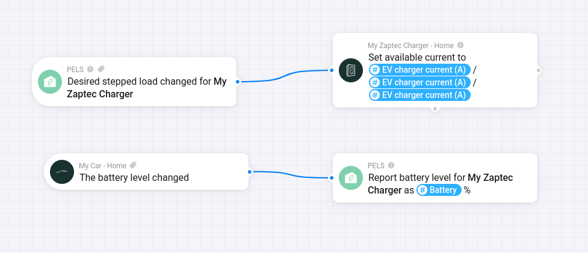

# Configure a Zaptec EV Charger

Start with [Configure an EV Charger](/ev-charger). This page only covers what is different for Zaptec.

Zaptec exposes the selected charger current to Homey, so PELS can read the current step automatically. You do not need the generic selected-current feedback Flow for Zaptec.

## Automatic charging power

A Zaptec app version that lets Homey set the charger's charging power offers **Automatic** under **Control model**, and a newly managed charger uses it. PELS then sets the charging power directly in the power levels the charger publishes, and the Zaptec app handles phases and the installation current. No key, Flow or EV phase model is needed, and the current setup below is not used. A charger PELS set up before keeps its manual setup until you choose **Automatic**.

The Zaptec app applies that power to the whole installation, so PELS uses it only for a charger with no other Zaptec charger on its installation.

## Built-in current control

Without **Automatic**, PELS sets the charging current. Open the charger's **Setup → Charging current** section. For an installation with one charger, confirm **This installation has only one charger**. PELS uses a writable current capability when the installed Zaptec app exposes one. Otherwise, create a Homey API key with **Flow** permission using [Homey's API-key guide](https://support.homey.app/hc/en-us/articles/8178797067292-Create-and-use-API-Keys-on-Homey-Pro), enter it here, and choose **Save key and enable**. If a key is already verified or the charger has a writable current capability, choose **Use built-in control**. One key works for all supported chargers on this Homey.

Before switching from an existing Flow, remove its current-setting action and choose **Check again**. Enable built-in control and check that the page says **Built-in current control is selected**. If you add a current-setting Flow later, PELS cannot stop it, and the two would override each other: the page then says **Built-in current control is paused**, PELS leaves the current to the Flow, and built-in control resumes on its own once you remove that action and choose **Check again**. Keep unrelated battery-level Flows. If you prefer a Flow, use the alternative below.

Zaptec's action changes the current for the whole installation. PELS refuses built-in current control when it knows of another charger on that installation. Only confirm a single-charger installation when that is true; otherwise keep your existing coordinated installation Flow.

## Flow alternative

Use a Flow only if you prefer it to built-in control, or for an installation with several Zaptec chargers that a Flow coordinates.

*Figure 1. Example Zaptec wiring: PELS emits the desired charger current, and the car battery level is reported back to PELS.*

Use this Flow shape:

| Flow part | Card |
| --- | --- |
| **When** | PELS: **Stepped device target changed** for your Zaptec charger |
| **Then** | Zaptec: **Set available current to** |

Choose **Use a Flow** in Charging current. PELS controls start and stop separately.

In the Zaptec action card, use the PELS Flow tag **EV charger current (A)** for the available-current value.

PELS handles the 1-phase or 3-phase conversion based on the EV control mode selected in PELS. Do not use **Planning power (W)** for the Zaptec current field unless you are intentionally building a manual conversion Flow.

## Battery Reporting

The Zaptec charger does not know the car's battery level. Select the car in the charger's **Car** section, or, with no car selected, report it with **Report battery level for charger** and choose the Zaptec charger in that card. See [EV charger battery reporting](/ev-charger#step-5-configure-boost-mode-battery-reporting).

## Related Pages

- [Configure an EV Charger](/ev-charger)
- [Flow Cards](/flow-cards)
