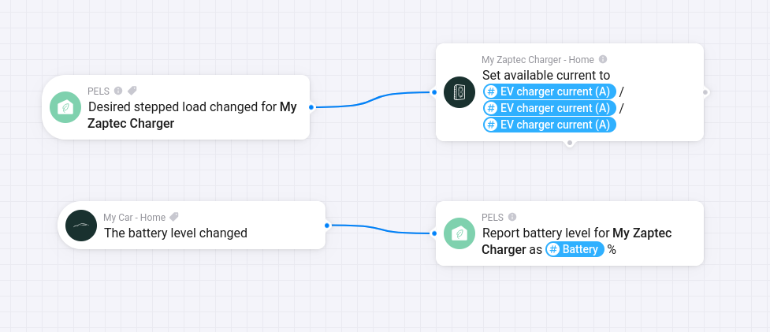

# Configure a Zaptec EV Charger

Start with [Configure an EV Charger](/ev-charger). This page only covers what is different for Zaptec.

Zaptec exposes the selected charger current to Homey, so PELS can read the current step automatically. You do not need the generic selected-current feedback Flow for Zaptec.

## Built-in current control

Open the charger's **Setup → Charging current** section. For an installation with one charger, confirm **This installation has only one charger**. PELS uses a writable current capability when the installed Zaptec app exposes one. Otherwise, create a Homey API key with **Flow** permission using [Homey's API-key guide](https://support.homey.app/hc/en-us/articles/8178797067292-Create-and-use-API-Keys-on-Homey-Pro), enter it here, and choose **Save key and enable**. If a key is already verified or the charger has a writable current capability, choose **Use built-in control**. One key works for all supported chargers on this Homey.

Before switching from an existing Flow, remove its current-setting action and choose **Check again**. Enable built-in control and check that the page says **Built-in current control is selected**. Keep unrelated battery-level Flows. If you prefer a Flow, use the alternative below.

Zaptec's action changes the current for the whole installation. PELS refuses built-in current control when it knows of another charger on that installation. Only confirm a single-charger installation when that is true; otherwise keep your existing coordinated installation Flow.

*Figure 1. Example Zaptec wiring: PELS emits the desired charger current, and the car battery level is reported back to PELS.*

## Flow alternative

Use this Flow shape:

| Flow part | Card |
| --- | --- |
| **When** | PELS: **Stepped device target changed** for your Zaptec charger |
| **Then** | Zaptec: **Set available current to** |

Choose **Use a Flow** in Charging current. PELS controls start and stop separately.

In the Zaptec action card, use the PELS Flow tag **EV charger current (A)** for the available-current value.

PELS handles the 1-phase or 3-phase conversion based on the EV control mode selected in PELS. Do not use **Planning power (W)** for the Zaptec current field unless you are intentionally building a manual conversion Flow.

## Battery Reporting

The generic EV charger guide covers battery reporting. For Zaptec, choose the same Zaptec charger in **Report battery level for charger** as you use in the current-control Flow.

That adds battery reporting to PELS, which can be used by EV boost mode.

## Related Pages

- [Configure an EV Charger](/ev-charger)
- [Flow Cards](/flow-cards)
